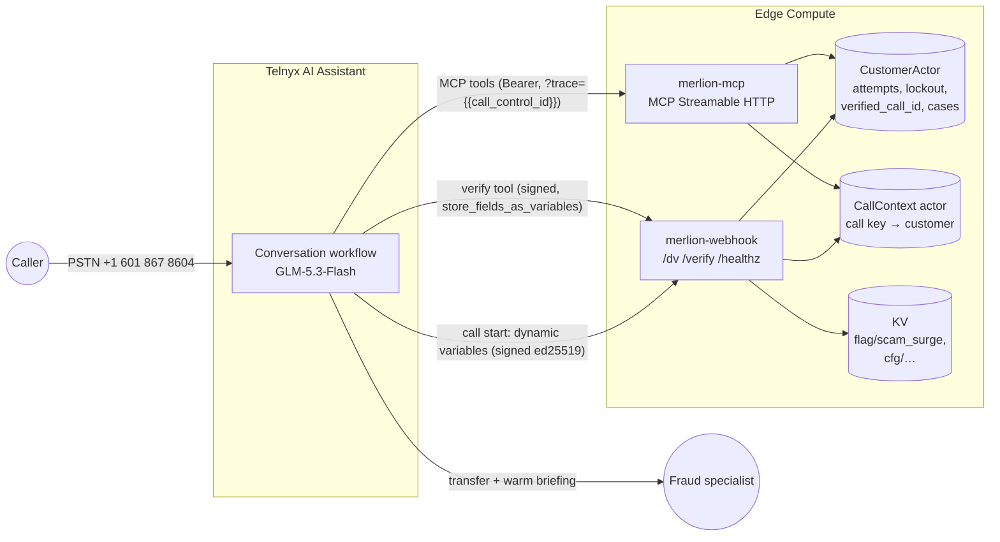

# Merlion Bank scam-response hotline (fictional)

A voice AI line for a fictional Singapore bank. People call it when they think they're being scammed. The assistant reads the mandatory disclosure word for word, checks suspicious SMS, links and numbers against a scam feed, verifies the caller without trusting caller ID, then freezes the card, opens a fraud case, or transfers the caller to a human with a briefing. It runs on a Telnyx AI Assistant with a conversation workflow, two Telnyx Edge Compute functions, StatefulActors and KV.

> **Call it:** +1 601 867 8604. Fictional personas are listed under [Try it](#try-it). All solution code was written in **OpenCode** on **Telnyx Inference** (Kimi-K3, with GLM-5.3-Flash as the small model; see `opencode.json`). Planning, design review and these docs were drafted with Claude Code, and the evidence for every claim is in `evidence/`.

## Try it

| Persona | Mobile (say it when asked) | DOB | Card last 4 | What to try |
| --- | --- | --- | --- | --- |
| Wei Ling (C001) | 8292 5458 | 17 Apr 1988 | 4251 | "I gave someone my OTP", then freeze, case, ask for a specialist (warm transfer) |
| Raj (C002) | 9123 4567 | 2 Nov 1975 | 8833 | "What's the status of my case?" (seeded case MB-C002-1) |
| Mei Yun (C003) | 9876 5432 | 30 Jun 1962 | 9917 | Give a wrong DOB 3 times → lockout; call again → locked notice |
| Daniel (C004) | 8123 4567 | 25 Jan 1995 | 1204 | "My card was stolen, freeze it" |
| anyone | n/a | n/a | n/a | "I got an SMS from Merlion Bank with a link merlion-secure-verify.com, is it real?" |

Reset the demo state with `. ~/.config/merlion/admin.env && sh scripts/reset-demo.sh`.

## Architecture



- **One actor type, two functions.** `merlion-webhook` owns `CustomerActor` and `CallContext`. `merlion-mcp` binds the same account-scoped actor types by reference. So verification written by `/verify` is the same state that gates `freeze_card` in MCP, with no extra sync layer (dogfooding #17).
- **KV holds slow-changing config only:** the scam-surge feature flag and its message. KV reads take about 1 s (#18), so nothing mid-call reads KV. The scam feed is bundled, and per-call state lives in actors (~30–60 ms warm).
- **One trace ID per call** (`call_control_id`, or the conversation ID on chat) is logged on every hop. `scripts/trace.sh` merges the transcript with both functions' logs.

### Workflow

```
welcome (speak) ─ account_locked=="true" ─► locked_notice ─► goodbye
   └ default ─► otp_disclosure (speak, verbatim) ─ scam_surge_alert=="true" ─► surge_notice
                                         └ default ─► triage (prompt)
triage ─ llm ─► scam_check (MCP check_scam_indicator) ─► police_advice
       ─ llm ─► verify_collect ─ verification_status=="verified" ─► verified_ack (speak) ─► secure_actions (freeze / case / status)
                               ─ verification_status=="locked"   ─► locked_notice
       ─ llm ─► escalate (transfer + warm briefing) ─ failed ─► escalate_failed
every prompt node ─ telnyx_conversation_duration_secs >= 300 ─► escalate
```

The full node and edge table, with all spoken text, is in `docs/design.md` §12. The things that matter:
- Speak nodes hold everything that must be said word for word: the disclosure, the lockout notice and the police advice. The model can't paraphrase compliance text.
- Edges on deterministic state use expression conditions on variables the webhook returns. LLM conditions are only used for intent.
- There's no edge for `failed`, so a wrong attempt stays in `verify_collect`, and the actor enforces the attempt limit.

## How the brief maps to the build

| Requirement | Where |
| --- | --- |
| AI Assistant + conversation workflow (speak / prompt / edges) | `assistant/assistant.json`, deployed by `assistant/deploy.mjs` (config as code, GET-back diff) |
| Dynamic variables webhook on Edge Compute | `merlion/webhook` `/dv`: caller lookup, lockout, open case, surge flag |
| MCP server on Edge Compute | `merlion/mcp`: `check_scam_indicator`, `freeze_card`, `open_fraud_case`, `get_case_status` |
| StatefulActor | `CustomerActor` (attempts, lockout, verification binding, cases) and `CallContext`, shared across both functions |
| KV | `flag/scam_surge`, `cfg/…` (feature flag drives a workflow branch) |
| Variable-comparison edges | `account_locked`, `scam_surge_alert`, `verification_status`, `telnyx_conversation_duration_secs >= 300` |
| Observability, tracing, "broken within a minute" | [Observability](#observability) |
| Testing | [Testing](#testing) |

## Key decisions and trade-offs

1. **Caller ID is not identity.** `/dv` uses caller ID only to *personalise* (for example, show the locked notice early). Nothing is disclosed or changed until `/verify` succeeds on mobile + DOB + card last 4. MCP tools take **no** customer ID from the model. The server resolves the customer from the verified binding for this call (#31).
2. **Use a model-called webhook tool for verify, not a workflow tool node.** Tool nodes skipped the HTTP call in 4 of 5 test calls (#14). A model-called tool with `store_fields_as_variables` reliably feeds the `verification_status` edges. `store_fields_as_variables` only stores fields from 2xx responses, so `/verify` always returns 200 with a business status (#16).
3. **Fail closed on security keys and auth:**
   - Ed25519 signatures on `/dv` and `/verify`.
   - Bearer auth on MCP, through an integration secret.
   - Call keys are rejected if they're empty or still contain `{{` (#30).
   - Deep health reports `sig_enforced` and `bad_call_key_rejected`, so the probe catches a bypass left on (#26).
4. **Keep latency off the call path.** KV (~1 s) and `env.SECRETS.get()` (~0.7 s) are out of the mid-call path, and secrets are read from deploy-time env (#18, #23). `/verify` takes about 40 ms warm. The `/dv` timeout is set to 3 s, because on timeout the call silently continues with builder defaults.
5. **Model: GLM-5.3-Flash** for the assistant. It's on the assistant allowlist, gave the best latency for voice, and the workflow carries the deterministic parts. Llama 3.3 was rejected for assistants (`10027`).
6. **US number for an SG bank.** SG DIDs need KYC documents, so the number is a +1 DID. Transfers to the SG mobile number needed SG added to the outbound voice profile (#21).
7. **Use speak nodes wherever the model kept double-speaking.** The text a model says alongside a tool call gets spoken, then it says it again after the result (#22, #36), and prompting didn't fix it reliably. The "you're verified" line is a speak node (`verified_ack`), so it's said exactly once. Trade-off: after a speak node, the next prompt node waits for the caller, so the caller says "go ahead" before hearing their case status.
8. **Tune voice for Singapore.** STT `keyterm` boosts "Merlion", "ScamShield", "NRIC" and the like ("Merlion" was heard as "Malayan"). A pronunciation dictionary fixes TTS for "Merlion" and "gov.sg"; it's attached through the undocumented `voice_settings.pronunciation_dict_id` (#37). Spoken URLs are normalised server-side, with fuzzy domain matching.
9. **Scope cuts:**
   - Multi-language specialist assistants (SG has 4 official languages): designed, then deferred to protect the English core.
   - Voicemail detection on transfer: we assume the specialist answers. Production would enable it.

## Debugging stories (the ones worth hearing)

- **#26: the signature check was left off in production.** A live repro flipped `DEV_SKIP_SIG`, and nobody flipped it back. A post-deploy probe caught unsigned `/verify` returning 200. The fix had to get past two `ship` HTTP 500s. Now the deep health check and the probe make that drift fail loudly.
- **#28 → #34: I misdiagnosed a model bug, and the fix was to distrust my own timeline.**
  - Merged traces seemed to show the model calling `verify` before the caller said "yes". I wrote it up, built an assert for it, and the back-test "caught" 3 calls.
  - Round-3 voice traces then showed a tool called with a URL ~20 s *before* the caller's message containing it was timestamped. That's impossible, so conversation message stamps lag by about one turn.
  - The model was fine. The assert and the back-test were wrong.
  - Lesson: calibrate cross-system clocks against an impossibility check, and use the real-time log tail as the truth.
- **#30: on chat, every session shared one auth key.** `{{call_control_id}}` isn't resolved on web_chat, so it arrives as literal text, and four different chats were verified under the key `"{{call_control_id}}"`. The fix fails closed on unresolved templates, keys chat by `{{telnyx_conversation_id}}`, and removes model-supplied identity from MCP.
- **#14: tool nodes silently skip their HTTP call**, and #22/#24: double-speak around transitions and tool calls. Both were fixed by changing the architecture and prompts, and the log has the evidence.

All 37 entries are in [`docs/dogfooding-log.md`](docs/dogfooding-log.md), with what happened, who found it, what we did, and the exact error text.

## AI tooling (dogfooding)

- **OpenCode + `@telnyx/opencode` on Telnyx Inference** wrote all of `merlion/`, `assistant/`, `scripts/` and `tests/`. Config: `opencode.json` (Kimi-K3 main, GLM-5.3-Flash small, autoupdate off).
- What worked:
  - It read the SDK `.d.ts` types for exact field names when the docs lagged (#13).
  - It ran its own live verification loops.
  - It stopped and reported when a platform piece failed (#29) instead of shipping something it couldn't test.
- What needed a human, or a second model, in the loop:
  - It left a dev bypass on (#26).
  - I misdiagnosed timestamp lag as a model bug, and a test encoded the mistake (#28 → #34). Second opinions cut both ways.
  - It reported the chat literal-template issue as a tracing nuance, not as the auth bypass it was (#30).
  - The lesson: generated code passed its own tests every time. The bugs only showed up when someone reviewed the deployed system against the live evidence.
- Setup friction, also logged: Kimi-K3 allowlisting, thinking-token handling, an OpenCode v2 plugin mismatch, and the brief's Edge CLI download URL returning 404 (#1–#6).

## Setup

Prerequisites: a Telnyx account with an API key, `telnyx-edge` CLI v0.6.0 or later, Node 22, and a Telnyx number.

1. **Functions.** In `merlion/`, add the secrets with `telnyx-edge secrets add`: `TELNYX_PUBLIC_KEY`, `DEV_SKIP_SIG=false`, `ADMIN_TOKEN`, `MCP_TOKEN`. Then run `telnyx-edge ship` for `webhook` and `mcp`. The webhook must ship first, because it owns the actor types.
2. **Assistant.** `node assistant/deploy.mjs` upserts the tools, the MCP server (plus the `merlion_mcp_token` integration secret) and the assistant, then prints a GET-back diff. IDs are recorded in `assistant/state.json`.
3. **Number.** Assign the number to the assistant. For transfers to SG, enable SG on the outbound voice profile.
4. **Check.** Run `scripts/probe.sh --once` (5 checks should be green) and `scripts/run-tests.sh`.

## Repo layout

```
merlion/webhook   /dv, /verify, /healthz, /admin/reset; owns CustomerActor + CallContext
merlion/mcp       MCP server (4 tools), references the shared actors
merlion/shared    personas, scam feed, logging, phone + call-key validation
assistant/        assistant + tools + MCP config as code, deploy.mjs, transcript helpers
scripts/          probe, metrics, trace, outcomes, run-tests, reset-demo
tests/            scenarios (config as code), sync, runner, deterministic asserts, backtest
docs/             design.md, spikes-runbook.md, dogfooding-log.md
evidence/         raw transcripts, logs, probe/metrics/test outputs behind every claim
spikes/           throwaway spikes that de-risked MCP-on-Edge, shared actors, tool nodes
```

## Known limitations and what's next

- The chat channel can verify but can't run MCP actions. Templating in the MCP URL doesn't resolve on chat (#33), and that's the intended fail-closed behaviour.
- The automated suite runs on web_chat. The phone_call runner is blocked on the platform side (#29), and the chat runner is flaky (#32).
- `revision` in health output is `null`: the runtime doesn't expose it (#27).
- Production would add:
  - a 60 s external synthetic with paging
  - voicemail detection on transfer
  - native-reviewed translations and the language specialists
  - a real core-banking backend behind the actors

## Testing

Two layers, deliberately different, so a flaky LLM judge can't hide a real regression:

| Layer | What | Where |
| --- | --- | --- |
| **Rubric** (LLM-judged) | Does the conversation read right? — via Telnyx Assistant Tests (`tests/scenarios/*.json`, suite `merlion-regression`, `tests/sync.mjs` keeps definitions in `tests/state.json`) | per-run `detail_status` |
| **Asserts** (deterministic) | Did the wiring do the right thing? — `tests/asserts.mjs` evaluates ordered `/verify` outcomes, MCP tool outcomes, transcript tool presence, and `no_verify_before` from **function logs** (the truth for tool timing, dogfooding #28) at `evidence/tests/<ts>/` | `scripts/run-tests.sh [T1…]` |

`run-tests.sh` resets demo state (`reset-demo.sh`), syncs scenarios, runs **sequentially over `web_chat`**, polls each run, pulls both functions' logs once, evaluates asserts per-scenario (window derived from each conversation's own message span), and exits non-zero on any rubric or assert failure. Channel is a per-scenario field (`channels: ["web_chat"]`) — flip to `phone_call` and the same suite runs on voice once the runner bug is fixed.

**Blocked:** the `phone_call` runner can't originate calls on our account (`RetryError[…HTTPStatusError]`, `turn_count: 0`, dangling `conversation_id`; `web_call` is accepted by the types but rejected by the runner). Details in `docs/dogfooding-log.md` #29. Live logic coverage therefore runs in chat; the voice-only surface stays manual.

**Manual (per release):** 3-call checklist on +1 601 867 8604 —
1. Unknown caller, suspicious-SMS path → `check_scam_indicator` + 1799 mentioned,
2. Verified path (C004) → freeze → case read back **digit by digit**, no double "thank you", STT digits correct,
3. Wrong DOB ×3 → locked notice; then the warm transfer actually rings a human (not voicemail).

**Cost per full run:** 7 tests × ~1–2 min ≈ **8–15 min wall**, plus ~8–10 min polling per setup; each run consumes one assistant conversation + its function calls (negligible $). The judge model adds LLM-judge latency only after the conversation ends.

**Offline mode:** `node tests/backtest.mjs` re-evaluates asserts against exported transcripts/logs in `evidence/` (see `evidence/tests/backtest.txt`) — it correctly flags the round-2 conversations that violated "verify only after confirmation".

## Observability

One voice call crosses four runtimes: the Telnyx AI Assistant (model + workflow),
`merlion-webhook` (/dv, /verify, /healthz, /admin/reset), `merlion-mcp` (MCP
tools), and StatefulActors (`CustomerActor`, `CallContext`). Everything below is
how we see it.

### What's instrumented

| Signal | Where it lives | Script |
| --- | --- | --- |
| Structured JSON logs (one line per hop: `ts, level, svc, route, trace_id, conversation_id, caller_masked, customer_id, outcome, status, duration_ms, kv_ms, actor_ms, err`) | `telnyx-edge logs <fn> --type runtime` | — |
| One `trace_id` (= `call_control_id`) across Assistant → Functions → Actors → MCP | same logs, plus platform invocations | `scripts/trace.sh <conversation_id>` |
| Deep health (KV read + actor ping + MCP self-check + `sig_enforced`) with no auth/PII | `GET /healthz?deep=1` on both functions | `scripts/probe.sh` |
| Synthetic probe every 60 s (also keep-warm): deep health, unsigned `/verify` must 401, unauthenticated `/mcp` must 401, MCP initialize + tools/list = 4 | laptop loop + GitHub Actions cron (5 min minimum, `.github/workflows/probe.yml`) | `scripts/probe.sh [--once]` |
| Platform metrics: request count, 2xx/4xx/5xx, p50/p95/p99, CPU/mem | `telnyx-edge metrics <fn> --json` | `scripts/metrics.sh` |
| Outcome counters (`ok/fallback/miss/verified/failed/locked/not_found/denied`) + p95 per route, derived from logs | logs | `scripts/outcomes.sh [hours]` |

`trace_id` linkage: `/dv` gets `call_control_id` in the webhook payload; `/verify`
and the MCP URL receive it via `{{call_control_id}}` in the shared-tool preset
fields and the assistant's MCP server URL. On web_chat, `{{call_control_id}}` arrives unresolved, so the webhook keys on `{{telnyx_conversation_id}}` instead, and any unresolved key is rejected (dogfooding #30). `scripts/trace.sh` pivots from a
conversation to that ID via the `/dv` log line (`conversation_id` → `trace_id`).

### "Broken within a minute" — the answer

The worst failure on this stack is **silent**: the dynamic-variables webhook
fires once per call and, on timeout, the call carries on with builder defaults —
it *sounds* fine. The cover is:

- **ALERT within 60 s.** `scripts/probe.sh` prints one JSON line per check and
  fires a macOS notification on the first failure; GitHub Actions runs
  `probe.sh --once` every 5 min as a laptop-independent net. (Production: a
  60 s external synthetic, e.g. Datadog Synthetics, with paging — the Actions
  cron only approximates it.)
- **Silent-failure modes watched explicitly:**
  - `/dv` timeout/5xx → `outcome=fallback` (still HTTP 200) is counted in
    `scripts/outcomes.sh` and the whole deep-health probe fails loudly.
  - Signature bypass left on (`DEV_SKIP_SIG`) → `/healthz?deep=1` reports
    `sig_enforced:false` (its `ok` flips to false) **and** the probe's unsigned
    `/verify` check expects 401. Drift alarms within a minute.
  - Transfer reaching voicemail counts as success on the platform — surfacing
    rule: watch transcripts for "specialist is busy" *not* being said, and the
    escalation edges; no metric shields this one, the trace shows it.
- **What to look at first:** `scripts/trace.sh <conversation_id>` on the failing
  call — it merges transcript turns, tool calls and both functions' log lines
  onto one timeline, so you see whether the failure was the webhook, the actor,
  MCP, or the model. Then `scripts/metrics.sh` for the platform-rate view
  (webhook p95 must stay well under the 3000 ms `/dv` timeout; ALERTs at
  1500 ms).

Cost notes for interpreting what you see (from the dogfooding log): KV and
`env.SECRETS.get()` are ~1 s sidecar RPCs while actor calls are ~30–60 ms warm —
all mid-call paths avoid KV/secrets, and `/healthz?deep=1`'s `kv_ms`/`actor_ms`
fields make the cost shapes visible on demand.
